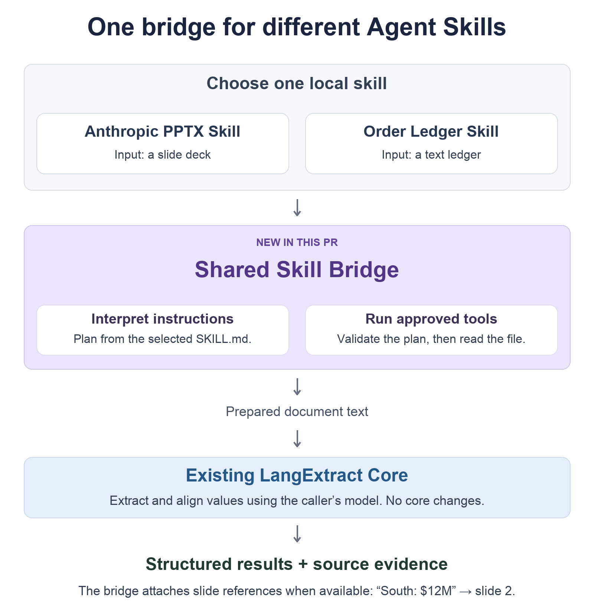

# Local Agent Skills as LangExtract inputs

**To use a new skill without writing a Python adapter**, see [Runtime skill bridge](RUNTIME.md). The selected `SKILL.md` body drives a model-generated preprocessing plan; the executor checks every operation against caller-granted tools before reading the document. Tested with the official PPTX skill and an unrelated order-ledger skill using the same executor and local language model.

## Alternative: deterministic, pinned PPTX adapter

The rest of this page documents the original no-planning-model baseline. Its digest check and registration requirements apply to that path, not to `extract_with_skill`.

Choose this prototype if you want a reviewed skill workflow, reproducible routing and slide references. If all you need is deck text, use MarkItDown directly. Nothing here changes what `lx.extract('report.pptx', …)` means. This is an independent example package, not a published plugin or a general Agent Skills runtime.

## Run it locally

From the LangExtract repository root, on macOS or Linux with Python 3.11:

```sh
python3.11 -m venv .venv
. .venv/bin/activate
python -m pip install -e . -e ./examples/skill_preprocessing pytest
# Explicit installation, not something the loader does:
git clone https://github.com/anthropics/skills /tmp/lx-example-skills
git -C /tmp/lx-example-skills checkout --detach 2c5958ecac7cee2b583967a2c4981d0f4a75c579
export LX_TEST_SKILL=/tmp/lx-example-skills/skills/pptx
cd examples/skill_preprocessing
python demo.py "$LX_TEST_SKILL"
python -m pytest tests -q
python compare.py "$LX_TEST_SKILL"
```

`demo.py` includes the prompt, example and a deterministic model for `tests/regions.pptx`. It runs real LangExtract parsing and alignment and prints JSON: `North: $12M` at `[17,28)` on slide 1 and `South: $12M` at `[126,137)` on slide 2. It warns about the blank third slide. This is a wiring test, not model-quality evidence. `python tests/generate.py` regenerates the synthetic presentation. Without `LX_TEST_SKILL`, the suite uses local test manifests and skips only the official-checkout test.

**Live smoke (opt-in):** configure a supported provider locally, then run `python demo.py "$LX_TEST_SKILL" --source tests/regions.pptx --model-id YOUR_CONFIGURED_MODEL`. This sends extracted text to that provider and may incur charges. Do not use confidential decks without authorization. The example prints results to your terminal; the parser itself does not log document text. Use `registry.parse(path)` for local conversion only.

## Contract and trust boundary

1. Authorize a stable local directory. `register_local` reads YAML name/description, inventories relative resource names and binds the manifest's exact SHA-256 to trusted adapter code. `allowed-tools`, prose, optional metadata and filenames grant no permissions. Script contents are neither loaded nor executed. Registration is not a general spec validator; it supports bounded plain frontmatter (no aliases) and the spec's common ASCII name profile.
2. Match the file extension deterministically. Pass `skill=` to select among registered adapters; zero or multiple matches fail closed. To extend, implement `suffix`, reviewed `digest`, and `parse(Path) -> ParsedDocument` in trusted application code and pass the adapter to `register_local`. Never derive Python import paths or commands from skill data.
3. The PPTX adapter implements only the pinned skill's **Read content** workflow, via MarkItDown's PPTX converter, not its thumbnail/editor scripts. The worker receives a bounded byte snapshot via stdin; no URL dispatch, provider clients, captioners, plugins, shell or credentials. Its cwd and HOME are temporary. ZIP members are never extracted. Limits: 16 MiB input/member, 64 MiB declared expansion, 2,048 entries, safe unique names, no DTDs in XML parts, 4 MiB output, 20 CPU seconds and 30 seconds wall time. Linux also limits address space to 2 GiB. Trusted interpreter and dependencies are required. This is **not an OS/network sandbox**; isolate it further for hostile multi-tenant workloads. Do not register concurrently modified skill trees.
4. The converter's ordered Markdown blocks are checked against the actual slide count, stripped of boundary markers and joined with two newlines. Offsets index Python characters in exactly the string sent as a `Document`; intervals are half-open. The sidecar contains original filename, byte-content digest, warnings and `(one_based_slide, start, end)` spans. Separators have no owner. Inconsistent markers yield document text but no slide mapping. Alignment comes from LangExtract, never from searching for the first occurrence. `mapped` requires exact aligned text; `approximate` is only a candidate slide, `cross-slide` lists overlaps, `unmapped` means no defensible slide. The sidecar cannot resolve an inherently ambiguous model answer or improve the core aligner's choice.
5. `extract_file` forwards caller extraction options and returns the unmodified annotated object alongside the parsed input and parallel origins. No provider-specific code or JSONL schema changes. Pass `model` or `model_id`/provider configuration as in LangExtract. Nothing from the skill is appended to model prompts. Deck text and model output remain untrusted data.

## Limits and troubleshooting

- **Unreviewed manifest:** check the commit, line endings and path. Current Anthropic main uses a different reader. Do not simply replace the digest: review conversion behavior, license and tests first.
- **No matching skill:** register before parsing; choose explicitly for ambiguity. `.ppt`, `.potx`, remote URLs, PDF, DOCX and XLSX are outside scope.
- **Invalid/resource-limited presentation:** inspect input size/format locally. Encrypted, oversized and malformed packages are not supported. Windows worker execution is not implemented. Do not disable quotas to process arbitrary uploads.
- Titles, text, simple tables, notes and cached simple chart data work in the tested files. No layout fidelity, coordinates, OCR, chart interpretation or exhaustive Office support. Images may appear as Markdown placeholders; image-only slides receive a warning, and a deck with no readable text fails. Heading/table punctuation is normalized Markdown, not raw Office XML. No shape/cell-level grounding.

For the no-registration API, execution trace, security limits and real-model acceptance test, see [Runtime skill bridge](RUNTIME.md).


